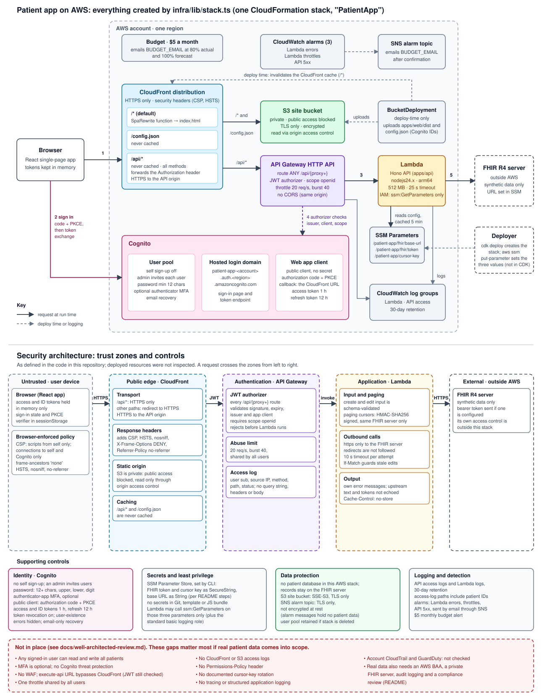

# Patient app

Practitioner-facing web app over a FHIR R4 server: list, search, create and edit patients, and view a clinical chart. Design and decisions are in [docs/plan.md](docs/plan.md).

**Synthetic data only.** Public FHIR servers are open to everyone. Real patient data needs an AWS BAA, a private FHIR server, audit logging and a compliance review first.

## Run locally

```sh
bun install
cp .env.example .env        # set FHIR_BASE_URL and CURSOR_KEY (32+ characters)
bun run apps/api/src/local.ts   # API on :8787, no login
cd apps/web && bun run dev      # web on :5173, proxies /api
```

Local runs have no login: the web app only asks for one when it finds `/config.json`, which exists only on AWS.

## Tests

Run from the repository root, after `bun install`.

```sh
bun run test            # unit, component and mock-server tests, and the CDK stack assertions
bun run test:e2e        # Playwright browser tests, mocked API
bun run typecheck       # type check
```

To run all three, stopping at the first failure:

```sh
bun run test && bun run test:e2e && bun run typecheck
```

```powershell
bun run test; if ($?) { bun run test:e2e }; if ($?) { bun run typecheck }
```

To run one part only:

```sh
bun test apps/api
bun test packages
bun test infra
(cd apps/web && bun test)                                  # web tests must run from apps/web
(cd apps/web && bunx playwright test e2e/login.e2e.ts)     # a single browser test file
```

- Use `bun run test`, not `bun test`: the script runs the web tests separately, from inside `apps/web`.
- The browser tests use the installed Microsoft Edge and a mocked `/api`, so they never call the real FHIR server. Playwright starts its own dev server on port 5199, which must be free.

## Architecture on AWS

```
Browser ──> CloudFront ─┬─ /*     → private S3 bucket (origin access control)
   │                    └─ /api/* → API Gateway HTTP API (JWT authorizer) → Lambda → FHIR server
   └──> Cognito hosted login (authorization code + PKCE)       Lambda reads SSM Parameter Store
```



The diagram ([docs/architecture.svg](docs/architecture.svg), also as [PNG](docs/architecture.png)) shows every resource in the stack, with a security view below it (trust zones, controls and open gaps). Keep it in step with [infra/lib/stack.ts](infra/lib/stack.ts) when resources change. Everything is in one CDK stack ([infra/lib/stack.ts](infra/lib/stack.ts)). The browser, the API and the login all share one CloudFront domain, so there is no CORS. Expected cost is under $1 a month (see plan section 4). There is no NAT gateway, VPC or always-on server, and the stack adds a $5 monthly budget alert and three CloudWatch alarms. Open findings from the [Well-Architected assessment](docs/well-architected-review.md) are listed there.

## Deploy

Deploying creates billable AWS resources. Get the product owner's approval first.

**Prerequisites:** Bun, AWS CLI signed in to the target account (`aws sts get-caller-identity` shows the right one), and `AWS_REGION` set (or a default region in your AWS profile).

**1. Create the three parameters.** The AWS CLI sets them, not CDK, so the token never enters Git, the template or the JS bundle.

```sh
aws ssm put-parameter --name /patient-app/fhir/base-url --type String       --value "https://your-fhir-server/fhir"
aws ssm put-parameter --name /patient-app/fhir/token    --type SecureString --value "none"    # or the real bearer token
aws ssm put-parameter --name /patient-app/cursor-key    --type SecureString --value "$(openssl rand -base64 48)"
```

- Use `none` (not an empty value, which SSM rejects) when the FHIR server needs no token.
- Type the token yourself; never paste it into chat, issues or a commit.
- PowerShell: replace the key value with
  `([Convert]::ToBase64String((1..48 | % { Get-Random -Maximum 256 }) -as [byte[]]))`.

**2. Deploy.** The first time in an account, bootstrap CDK (creates a staging bucket and roles; one-off per account and region).

```sh
export BUDGET_EMAIL=you@example.com   # PowerShell: $env:BUDGET_EMAIL = "you@example.com"
(cd infra && bunx cdk bootstrap)  # first time only
bun run deploy                    # builds the web app, then cdk deploy
```

The outputs give `SiteUrl`, `UserPoolId` and `WebClientId`.

**Confirm the alarm emails.** AWS sends `BUDGET_EMAIL` a subscription confirmation; click its link, or no alarm emails arrive. The alarms cover Lambda errors, Lambda throttles and API 5xx responses. API access logs and Lambda logs are kept for 30 days.

**3. Invite a user.** Self sign-up is off. Each user is invited by an admin, gets a temporary password by email and sets their own at first login (optional authenticator-app MFA is offered). Share the `SiteUrl` with them separately.

```sh
aws cognito-idp admin-create-user --user-pool-id <UserPoolId> --username person@example.com \
  --user-attributes Name=email,Value=person@example.com Name=email_verified,Value=true
```

The default Cognito email sender is limited to about 50 messages a day, which is plenty here.

**Remove a user**

```sh
aws cognito-idp admin-delete-user --user-pool-id <UserPoolId> --username person@example.com
```

They can't sign in or refresh again. A token they already hold works until it expires (at most 1 hour).

## Redeploy after a change

Use this for any change to the web app, the API, the shared package or the CDK stack. A change to an SSM parameter alone needs no redeploy (see the next section).

Run from the repository root.

**1. Set the region and alert email** in every new shell. Use the region the stack is already in (`us-east-1` here), even if your AWS profile defaults to another; otherwise CDK creates a second stack. Use the same email as before, or the alert subscriptions move to the new address and it must be confirmed.

```sh
export AWS_REGION=us-east-1
export BUDGET_EMAIL=you@example.com
```

```powershell
$env:AWS_REGION = "us-east-1"
$env:BUDGET_EMAIL = "you@example.com"
```

**2. Check the change.**

```sh
bun install          # picks up dependency changes
bun run typecheck
bun run test
```

**3. Preview what will change in AWS.** The build comes first because CDK reads `apps/web/dist`.

```sh
bun run build
bunx --cwd infra cdk diff
```

Stop and investigate if:

- every resource shows as new: the region or account is wrong;
- the user pool shows as replaced or removed: the app would switch to a pool without your users.

**4. Deploy.**

```sh
bun run deploy
```

This rebuilds the web app, updates the stack, uploads the site and clears the CloudFront cache. Approve the prompt if CDK asks about permission changes, after reading them.

**5. Verify.** Reload the site, sign in and open the patient list and a chart. If a request fails, read the Lambda log. Its group name starts with `PatientApp-ApiLogs`:

```sh
aws logs describe-log-groups --region us-east-1 --log-group-name-prefix PatientApp-ApiLogs --query "logGroups[].logGroupName" --output text
aws logs tail <log-group-name> --region us-east-1 --since 15m
```

A `config error:` line names the SSM setting that is wrong.

**Roll back** by checking out the last good commit and repeating steps 1, 3 and 4.

## Change the FHIR server or token

Update the parameter, no redeploy needed. The API picks it up within 5 minutes, or at once after a 401 from the FHIR server.

```sh
aws ssm put-parameter --name /patient-app/fhir/base-url --type String --overwrite --value "https://other-server/fhir"
```

## Tear down

```sh
cd infra && bunx cdk destroy
aws ssm delete-parameters --names /patient-app/fhir/base-url /patient-app/fhir/token /patient-app/cursor-key
```

Destroy removes the bucket (and its contents), API, Lambda, logs, alarms and budget. **The user pool and its users are kept.** A later deploy creates a new, empty pool and does not reconnect the old one. To delete the kept pool and its users for good:

```sh
aws cognito-idp delete-user-pool --user-pool-id <UserPoolId>
```

`cdk bootstrap` resources stay; delete the `CDKToolkit` stack if the account no longer needs CDK.

## Check a deployment

After deploying, from any shell (`$SITE` is the `SiteUrl` output):

```sh
curl -si $SITE/api/patients | head -1                       # 401: the API needs a login
curl -si $SITE/patients/123 | head -1                       # 200: deep links serve the app
curl -s  $SITE/config.json                                  # Cognito IDs only, no secrets
curl -si https://<bucket>.s3.amazonaws.com/index.html | head -1   # 403: S3 is not public
grep -rl "<your FHIR token>" apps/web/dist || echo "no token in bundle"   # use the real token value
```

Then sign in in a browser, open a patient chart, refresh on that URL, and change the base-url parameter to confirm it takes effect without a redeploy.

## Layout

```
apps/web      React SPA (Vite, Mantine, Lucide)
apps/api      Hono API: lambda.ts on AWS, local.ts on Bun
packages/shared  Zod schemas, view types, constants
infra         CDK stack and its assertions
docs          plan.md, synthetic-data-plan.md, well-architected-review.md
```
